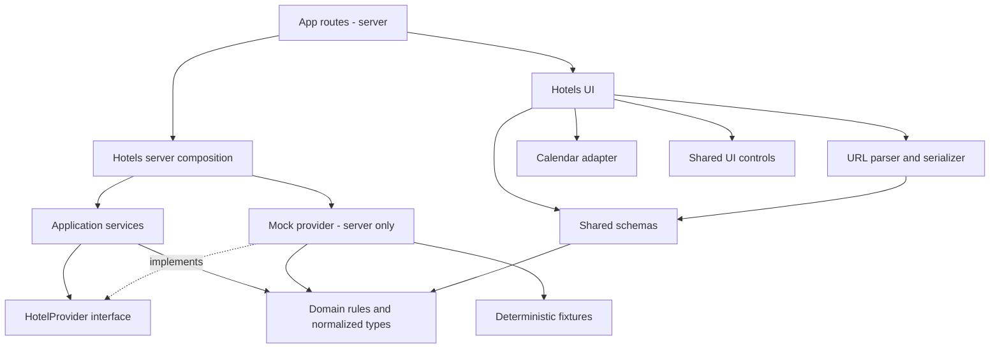

# معماری جریان هتل

وضعیت این سند: معماری نسخه پیاده‌سازی‌شده. ساختار اصلی زیر در برنامه وجود دارد؛ نتایج بررسی و تفاوت‌های محیط اجرا در [گزارش بررسی](verification.md) ثبت می‌شوند. این معماری برای یک قابلیت کامل در بودجه محدود انتخاب شده و دلیل تصمیم‌ها در [تصمیم‌های فنی](decisions.md) آمده است.

## ساختار و مرز مسئولیت‌ها

```text
src/
  app/
    layout.tsx
    page.tsx
    not-found.tsx
    icon.svg
    hotels/
      page.tsx
      loading.tsx
      error.tsx
      [hotelId]/
        page.tsx
        not-found.tsx
  features/
    hotels/
      domain/             # Types, capacity, pricing, filtering, sorting
      schemas/            # Shared Zod input and output validation
      application/        # Search/details services and provider interface
      ui/                 # Search form, result card, filters, preview
      url-state.ts        # Pure query parser and serializer
      public.ts           # Client-safe exports only
      server.ts           # Server-only service composition
  components/
    ui/                   # Shared controls with actual reuse
  infrastructure/
    hotels/
      mock-provider.ts
      fixtures.ts
  lib/
    dates/                # Pure date-only arithmetic and calendar adapter
    env.server.ts
tests/
  e2e/
public/
  images/hotels/
```

تست واحد و کامپوننت کنار کد مربوط قرار می‌گیرد. `app` هماهنگ‌کننده مسیر و نمایش است؛ فرمول قیمت و اعتبار تاریخ در صفحه تعریف نمی‌شود. Typeهای هتل در domain و schemaها در schemas نگهداری می‌شوند. Type ورودی از schema استخراج می‌شود تا تعریف موازی ایجاد نشود.

صفحه ریشه `/` به `/hotels` هدایت می‌شود؛ صفحه فرود جداگانه‌ای در این نسخه ساخته نمی‌شود.

`components/ui` فقط اجزای عمومی با استفاده واقعی را می‌گیرد. کارت هتل و فیلتر ستاره متعلق به Feature هستند. `lib` محل utility مرتبط با زیرساخت مشترک تاریخ و تنظیمات است؛ منطق اختصاصی هتل به آن منتقل نمی‌شود.

## جهت وابستگی‌ها



پیکان پیوسته جهت وابستگی کد است. application فقط قرارداد provider را می‌شناسد و آداپتور از بیرون به آن داده می‌شود. `server.ts` محل اتصال آداپتور به سرویس است؛ با `import 'server-only'` از ورود آن به کلاینت جلوگیری می‌شود. آداپتور و env سروری نیز همین محافظ را دارند.

دامنه هیچ importی از React، Next.js، DateObject یا env ندارد. TypeScript importهای صرفاً Type با `import type` مشخص می‌شوند. `public.ts` زیرساخت یا entry سروری را export نمی‌کند؛ از barrel واحدی که سرور و کلاینت را مخلوط کند استفاده نمی‌شود.

## مسیر داده و مدیریت وضعیت

1. صفحه `/hotels` پارامترهای درخواست را با parser مشترک می‌خواند. بدون جست‌وجو، فرم خالی و راهنمای شروع نمایش داده می‌شود؛ با ورودی نامعتبر، پیام اعتبارسنجی نشان داده می‌شود و سرویس فراخوانی نمی‌شود.
2. سرویس `searchHotels` ورودی معتبر و provider را دریافت می‌کند. provider داده نامزد را می‌آورد و آن را به مدل مشترک تبدیل و اعتبارسنجی می‌کند؛ فیلتر و مرتب‌سازی دامنه در سرویس اعمال می‌شوند.
3. نتیجه از Server Component به کارت‌های سروری می‌رسد. فرم، فیلترها و مرتب‌سازی Client Componentهای کوچک هستند. نتیجه کامل داخل Store یا state فرم کپی نمی‌شود.
4. ثبت فرم یا کنترل‌ها URL را طبق قرارداد تغییر می‌دهد؛ navigation بعدی روی سرور نتیجه جدید می‌سازد. فرم روی تغییر query معتبر، از جمله Back/Forward، با مقدار ثبت‌شده reset می‌شود.
5. جزئیات، همان اطلاعات اقامت را از URL اعتبارسنجی و از provider دریافت می‌کند. پیش‌نمایش، داده معتبر سرور را می‌گیرد؛ مبلغ دلخواه از URL خوانده نمی‌شود.

| نوع وضعیت | محل نگهداری | نمونه |
| --- | --- | --- |
| داده سرور | نتیجه سرویس در render سرور | فهرست هتل و جزئیات |
| وضعیت ثبت‌شده و قابل اشتراک | URL | شهر، تاریخ، ظرفیت، فیلتر و sort |
| ورودی ثبت‌نشده | React Hook Form | انتخاب ناقص بازه تاریخ |
| تعامل زودگذر | state محلی | بازبودن فیلتر موبایل یا پیش‌نمایش |

متن شمسیِ در حال ویرایش در state محلی فرم می‌ماند تا رشته ناقص کاربر قابل ادامه‌دادن باشد. این متن مدل دوم جست‌وجو نیست: در هر تغییر، آداپتور مقدار معتبر یا خالی را به React Hook Form می‌دهد؛ فقط schema همان فرم ورودی قابل ثبت را تعیین می‌کند. انتخاب تقویم متن‌ها را همگام می‌کند و remount روی تغییر URL هر دو را بازنشانی می‌کند.

از HTTP به خود برنامه برای دریافت همان سرویس استفاده نمی‌شود. Route Handler فقط اگر بعداً مصرف‌کننده HTTP واقعی وجود داشته باشد اضافه خواهد شد. داده Mock همچنان از سرویس async می‌آید و در UI ثابت نوشته نمی‌شود.

## مرزهای رندر و تجربه انتظار

صفحه و کارت‌ها سروری باقی می‌مانند. جزیره‌های تعاملی شامل فرم، جعبه جست‌وجوی مقصد، تقویم، پنل اتاق و مسافر، کنترل فیلتر و کشوی فیلتر موبایل، مرتب‌سازی، گالری lightbox، نقشه Leaflet و پنجره پیش‌نمایش‌اند. Client بودن یک کنترل نباید تمام فهرست را وارد bundle آن کند. نقشه فقط در کلاینت با `dynamic` و `ssr: false` بارگذاری می‌شود. این تفکیک با [راهنمای رسمی Server و Client Components](https://nextjs.org/docs/app/getting-started/server-and-client-components) سازگار است.

`loading.tsx` انتظار ورود به مسیر را پوشش می‌دهد. نتیجه async در Suspense با کلید query نرمال‌شده قرار می‌گیرد تا تغییر query نیز fallback مناسب داشته باشد؛ صرف وجود loading مسیر، شاهد Loading همه navigationها نیست. کنترل‌ها هنگام transition وضعیت انتظار قابل مشاهده دارند. فرم حین انتظار از بین نمی‌رود.

خطای قابل انتظار provider به نتیجه typed و پیام فارسی با اقدام تلاش مجدد تبدیل می‌شود. `error.tsx` مرز خطای غیرمنتظره است و جزئیات داخلی را نمایش نمی‌دهد. `not-found.tsx` برای شناسه هتل ناموجود است؛ ورودی تاریخ نامعتبر به صفحه ۴۰۴ تبدیل نمی‌شود. قرارداد [خطاها](contracts.md) بین این حالت‌ها تمایز می‌گذارد.

## تاریخ و جلوگیری از اختلاف رندر

سرور «امروز تهران» را یک بار برای درخواست محاسبه و به فرم به شکل date-only می‌فرستد. کلاینت در اولین render آن را دوباره با timezone دستگاه محاسبه نمی‌کند. تاریخ ثبت‌شده رشته ساده و locale صریح دارد؛ DateObject فقط در آداپتور تقویم ساخته می‌شود. بازه ناقص فقط وضعیت فرم است و وارد سرویس نمی‌شود.

از پنهان‌کردن mismatch با `suppressHydrationWarning` استفاده نمی‌شود. اگر کتابخانه در نسخه منتخب واقعاً وابسته به API مرورگر باشد، فقط widget تقویم به‌صورت client-only با placeholder هم‌اندازه بارگذاری می‌شود؛ این کار به کل صفحه گسترش نمی‌یابد.

## توسعه تأمین‌کننده و تنظیمات

برای افزودن تأمین‌کننده، یک آداپتور سروری با قرارداد [HotelProvider](contracts.md) ایجاد می‌شود. درخواست، تبدیل پاسخ، timeout و خطاهای provider در همان آداپتور قرار می‌گیرند. سپس اتصال در `server.ts` عوض و سناریوهای قرارداد provider اجرا می‌شوند. UI و قواعد فیلتر و قیمت تغییری نمی‌کنند. تجمیع هم‌زمان چند provider در نسخه فعلی پیاده‌سازی نمی‌شود.

در حالت Mock کلید API لازم نیست. پیکربندی سروری Mock و نام متغیرها در قراردادها تعریف شده‌اند. `env.server.ts` مقدار نامعتبر تنظیمات را هنگام راه‌اندازی گزارش می‌کند؛ آن را به حالت موفقیت خاموش تبدیل نمی‌کند. برای provider خارجی آینده، کلیدها بدون پیشوند `NEXT_PUBLIC_` و فقط در سرور خوانده خواهند شد؛ `.env.example` فقط نام و مقدار نمونه غیرمحرمانه دارد و `.env.local` وارد Git نمی‌شود.

برای جست‌وجوی خارجی آینده، `fetch` صریحاً `cache: 'no-store'` دارد و با `revalidate` متناقض ترکیب نمی‌شود. فراخوانی مستقیم Mock، HTTP fetch نیست و گزینه cache ندارد؛ برای جست‌وجوی وابسته به درخواست در کش سراسری قرار نمی‌گیرد. رفتار واقعی بر نسخه نصب‌شده و اجرای build بررسی و در تصمیم‌ها ثبت خواهد شد. [مرجع fetch](https://nextjs.org/docs/app/api-reference/functions/fetch).

تصاویر نمونه محلی با حق استفاده مشخص، اندازه معلوم، alt فارسی و `next/image` ارائه می‌شوند. `sizes` با عرض واقعی کارت در موبایل و دسکتاپ تطبیق می‌یابد؛ همه تصاویر priority نمی‌گیرند. فونت فارسی دارای مجوز به شکل محلی و با مسیر بارگذاری مشخص استفاده می‌شود. ابعاد رزروشده تصویر و Skeleton از جابه‌جایی چیدمان جلوگیری می‌کنند.

## ملاحظات نسخه ساخته‌شده

محاسبه روز، تعداد شب و امروز تهران در `lib/dates/date-only.ts` از آداپتور DateObject جدا شده است؛ دامنه برای قیمت‌گذاری به کتابخانه تقویم نیاز ندارد. نام فایل‌ها و جهت وابستگی‌ها مطابق این مرزهاست. در نسخه بررسی‌شده Webpack و API کامپایلر TypeScript استفاده می‌شوند؛ بررسی TypeScript حذف نشده است.

فرم، فیلتر و مرتب‌سازی از `SearchNavigationProvider` برای وضعیت موقت navigation استفاده می‌کنند. این provider با children سروری ترکیب می‌شود و داده نتایج را به کلاینت منتقل نمی‌کند. pending تا commit شدن navigation است؛ تمام مدت دریافت stream را الزاماً پوشش نمی‌دهد. هدف، جلوگیری از ثبت هم‌زمان query مبتنی بر props قدیمی است.

AGENTS.md و Skill منابع تحت کنترل پروژه‌اند؛ تولید خودکار قواعد عامل Next غیرفعال است. next-env.d.ts خروجی تولیدشدنی Next است و در مخزن نسخه‌بندی نمی‌شود.
